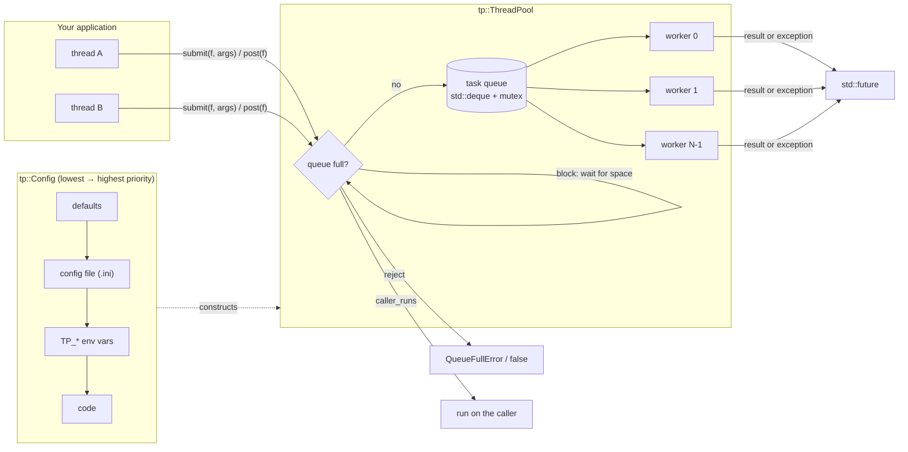

# tp — C++17 thread pool

A small, dependency-free thread pool for C++17. Integrate it with one CMake line,
configure it from a file, environment variables or code.

- `submit()` returns a typed `std::future`; `post()` is fire-and-forget
- Bounded queue with `block` / `reject` / `caller_runs` overflow policies
- `drain` / `discard` shutdown, stats, pluggable logging
- Optional CPU pinning and thread names (Linux, Windows, macOS)

## Architecture



Workers sleep on a condition variable while the queue is empty. A producer
wakes a sleeper only if the wakeups already in flight can't cover the queued
tasks, which avoids a lock convoy when many workers are idle.

## Quick start

```cpp
#include <tp/thread_pool.hpp>

tp::ThreadPool pool;                                     // defaults + TP_* env
auto sum = pool.submit([](int a, int b) { return a + b; }, 2, 3);
pool.post([] { /* fire and forget */ });
int five = sum.get();                                    // rethrows task exceptions
pool.waitIdle();                                         // queue empty, workers idle
// ~ThreadPool(): shuts down with the configured policy (drain by default)
```

## Integration

Link `tp::thread_pool` and include `<tp/thread_pool.hpp>`. Pick one:

```cmake
# 1. FetchContent (pin GIT_TAG to a commit or tag)
include(FetchContent)
FetchContent_Declare(tp GIT_REPOSITORY https://github.com/TieuBao168/thread-pool-cplusplus.git GIT_TAG main)
FetchContent_MakeAvailable(tp)

# 2. Vendored copy
add_subdirectory(third_party/thread-pool-cplusplus)

# 3. Installed package:  cmake --install build --prefix /opt/tp
find_package(tp CONFIG REQUIRED)

target_link_libraries(my_app PRIVATE tp::thread_pool)
```

As a subproject, tp builds only the library (no tests, examples or install rules).

## Configuration

Priority: **defaults < config file < `TP_*` environment < code**.

| Key | Values | Default | Env override |
|-----|--------|---------|--------------|
| `num_workers` | integer, `0` = hardware threads | `0` | `TP_NUM_WORKERS` |
| `queue_capacity` | integer, `0` = unbounded | `0` | `TP_QUEUE_CAPACITY` |
| `overflow_policy` | `block` \| `reject` \| `caller_runs` | `block` | `TP_OVERFLOW_POLICY` |
| `shutdown_policy` | `drain` \| `discard` | `drain` | `TP_SHUTDOWN_POLICY` |
| `cpu_affinity` | `none` \| `round_robin` \| `0,2,4` | `none` | `TP_CPU_AFFINITY` |
| `thread_name` | base name, workers get `<name>-<i>` | `tp-worker` | `TP_THREAD_NAME` |
| `log_level` | `off` \| `error` \| `warn` \| `info` \| `debug` | `warn` | `TP_LOG_LEVEL` |

```ini
# threadpool.ini — every key is optional; see config/threadpool.ini.example
num_workers     = 4
queue_capacity  = 1024
overflow_policy = reject
```

```cpp
tp::ThreadPool a;                       // $TP_CONFIG_FILE if set, else defaults; + env
tp::ThreadPool b("threadpool.ini");     // file + env; throws tp::ConfigError if unusable
tp::ThreadPool c(tp::Config{}.workers(4).queueCapacity(1000));    // code only

auto cfg = tp::Config::load("threadpool.ini");                    // file + env ...
cfg.onOverflow(tp::OverflowPolicy::CallerRuns);                   // ... then code wins
tp::ThreadPool d(cfg);
```

Errors name the source, e.g. `threadpool.ini:7: unknown key 'num_wrkers'`.
CPU pinning is best effort (not available on macOS); failures are logged.
Route logs to your own logger with `Config::logSink(fn)`.

## API

| Member | Behavior |
|--------|----------|
| `submit(f, args...)` | Returns `std::future<R>`. Throws `QueueFullError` (reject) or `PoolStoppedError`. |
| `post(f, args...)` | Returns `false` if refused. Exceptions are logged and counted in `stats().failed`. |
| `waitIdle()` | Blocks until the queue is empty and no task runs. |
| `shutdown([policy])` | Stops accepting work, drains or discards, joins workers. Idempotent. |
| `stats()` | `workers`, `pending`, `active`, `completed`, `failed`, `rejected`. |
| `size()`, `isRunning()`, `config()` | Worker count, state, effective config. |

All members are thread-safe. Calling `waitIdle()` or `shutdown()` from a task
throws `std::logic_error` instead of deadlocking. Tasks may submit more tasks.

## Verification

| Check | Scope |
|-------|-------|
| Unit tests | 46 tests: 26 config, 20 pool (results, exceptions, all overflow and shutdown policies, nested submit, 2000× create/destroy regression for the old shutdown hang) |
| Compilers | GCC, Clang, AppleClang, MSVC — Debug and Release, warnings as errors |
| Sanitizers | ThreadSanitizer, AddressSanitizer + UndefinedBehaviorSanitizer |
| Integration | A consumer project builds and runs via `find_package`, `add_subdirectory` and `FetchContent` |
| Container | Docker image builds and runs the tests on `ubuntu:24.04` |
| Stability | Pool tests repeated 300× locally without a failure |

All of the above runs in [CI](.github/workflows/ci.yml) on every push and pull request.

## Performance

`tp_bench_throughput`: one producer `post()`s N tasks, then `waitIdle()`.
Median of 3 runs, Release, AMD Ryzen 7 8845HS (8 cores / 16 threads), Windows, MinGW GCC 15.

| Workers | empty task | ~1 µs task | ~50 µs task |
|--------:|-----------:|-----------:|------------:|
| 1  | 7.64 M/s | 934 k/s | 19.9 k/s |
| 2  | 4.03 M/s | 1.69 M/s (1.8×) | 37.2 k/s (1.9×) |
| 4  | 1.39 M/s | 2.83 M/s (3.0×) | 77.3 k/s (3.9×) |
| 16 | 0.31 M/s | 385 k/s | 295 k/s (14.8×) |

Linux, GitHub Actions runner (AMD EPYC 9V74, 4 threads), GCC, single run:

| Workers | empty task | ~1 µs task | ~50 µs task |
|--------:|-----------:|-----------:|------------:|
| 1 | 4.10 M/s | 931 k/s | 19.9 k/s |
| 2 | 3.22 M/s | 1.64 M/s (1.8×) | 40.5 k/s (2.0×) |
| 4 | 1.07 M/s | 2.10 M/s (2.3×) | 78.0 k/s (3.9×) |

What this shows: tasks of ~50 µs scale almost linearly on both platforms.
Tiny tasks are limited by the single shared queue mutex, so more workers add
contention. Give each task at least a few microseconds of work, or batch small
items into one task. Every CI run republishes these numbers in the `benchmark`
job summary.

Reproduce: `make bench`, or `./build/tp_bench_throughput [num_tasks]`.

## Build from source

```bash
cmake -S . -B build -DTP_WARNINGS_AS_ERRORS=ON
cmake --build build --parallel
ctest --test-dir build --output-on-failure
cd build && ./tp_pusher_demo threadpool.ini 2 5   # demo: config, producers, seconds
```

Options: `TP_BUILD_TESTS`, `TP_BUILD_EXAMPLES`, `TP_BUILD_BENCHMARKS`, `TP_INSTALL`
(on when top-level), `TP_WARNINGS_AS_ERRORS`, `BUILD_SHARED_LIBS`.
`make` / `make test` / `make bench` / `make install PREFIX=...` wrap the same steps.

```
include/tp/   public headers (config.hpp, thread_pool.hpp)
src/          implementation and per-OS helpers
tests/        unit tests and the consumer project used by CI
examples/     basic usage, pusher_demo (the original demo)
benchmarks/   throughput benchmark
config/       threadpool.ini.example
```

## Migrating from the old API

| Old | New |
|-----|-----|
| `pool.initialize("file")` / `ConfigLoader` | `tp::ThreadPool pool("file")` / `tp::Config::load("file")` |
| `pushTask(new TaskData(f, args...))` | `pool.post(f, args...)` or `pool.submit(...)` |
| `sleep_for(...)` to wait for tasks | `pool.waitIdle()` |
| `NUMS_OF_WORKER`, `worker_count`, `queue_size` | still read, with a deprecation warning |
| task pushers, `lifecycle_timeout` | application code; see `examples/pusher_demo` |

## License

MIT — see [LICENSE](LICENSE).
